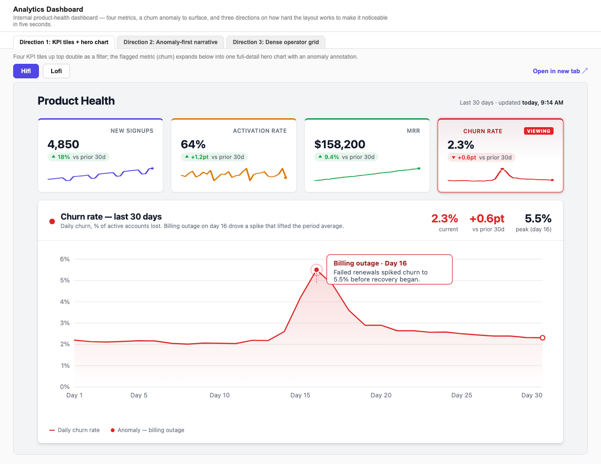
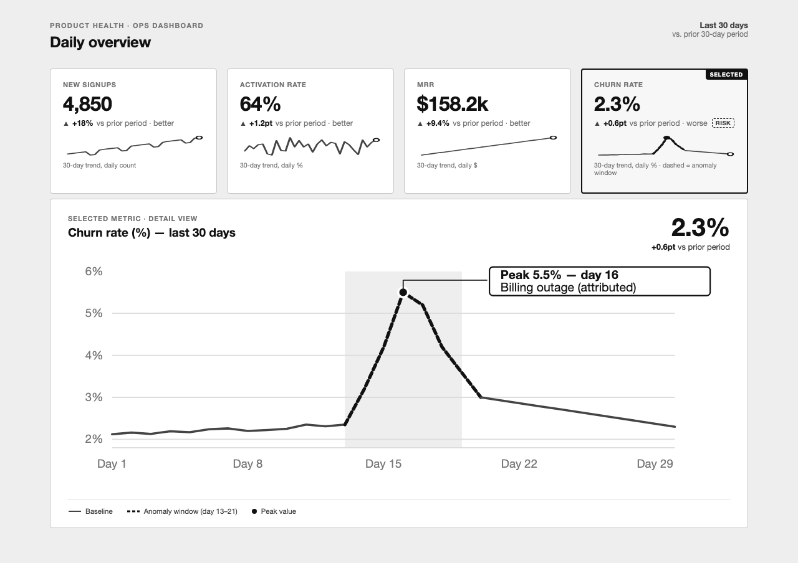
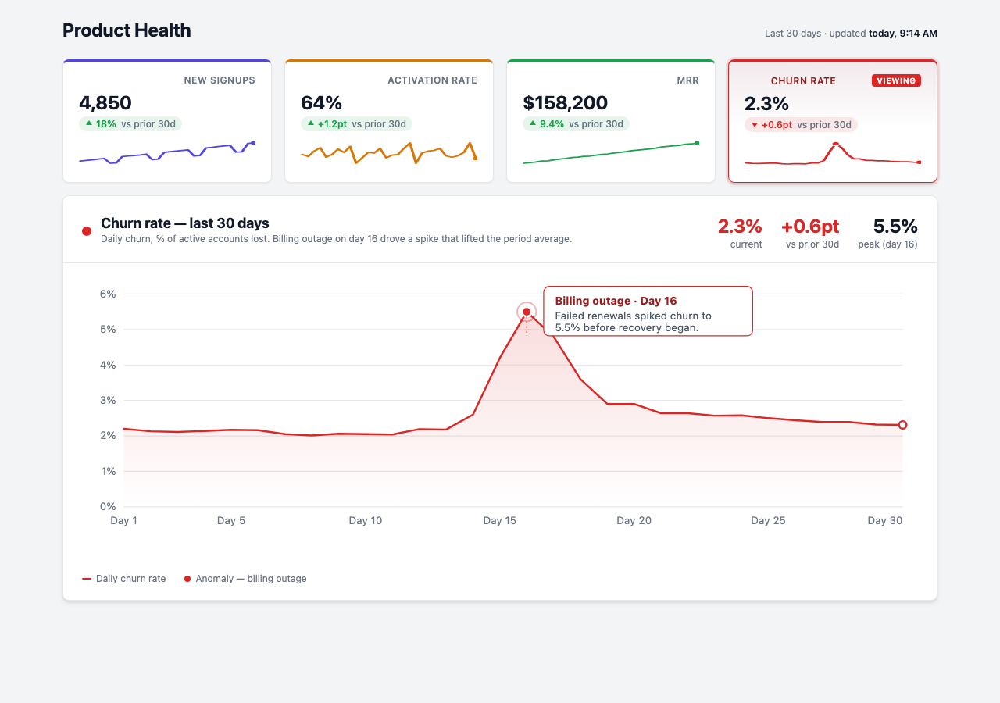

# rapid-prototyping-kit

**It's a design sprint, minus the sprint.**

Claude Code skills that turn a written brief into genuinely distinct lofi +
hifi HTML mockups. No build step — every mockup is self-contained HTML you
open via `file://`. Bring your own design tokens.



## Where this fits in a design sprint

The five-day sprint runs Understand → Sketch → Decide → Prototype →
Validate, and Sketch gets a whole day of its own because divergence has to
be protected from production — you can't decide between one idea and
nothing.

Sketch and Prototype are the days this kit collapses: one brief in, a
handful of genuinely different directions out, each already at two fidelity
tiers — a lofi wireframe for arguing about structure before anyone's
distracted by color, and a hifi pass real enough to hand to a user in a
Validate session.

It doesn't replace a sprint. There's no facilitated Decide here and no user
in the room. It makes the diverge part affordable when there's no capacity
to run the real thing.

Not technical? Start with
[`GUIDE_FOR_NON_TECHNICAL_USERS.md`](GUIDE_FOR_NON_TECHNICAL_USERS.md)
instead — this README assumes you're comfortable in a terminal.

## Requirements

- [Claude Code](https://claude.com/claude-code)
- Node.js ≥ 18, for screenshotting only: `cd scripts && npm install`
- macOS or Linux

## Quickstart

```
git clone https://github.com/yoanad/rapid-prototyping-kit
cd rapid-prototyping-kit
```

This repo is designed to be driven through Claude Code chat, not by
hand-writing files. Open the repo in Claude Code and:

**No brief yet?**
> "I want to design a pricing page, no brief written yet."

Claude interviews you (what it is, who uses it, must-include content, tone,
brand, reference) and writes `features/pricing-page/brief.md`. It stops
there and asks before generating anything — add reference screenshots to
`features/pricing-page/reference/` first if you have them.

**Have a brief already?**
> "Here's the brief for a pricing page: <paste>. Generate 3 directions."

Claude picks 3 distinct creative angles itself, then generates lofi + hifi
HTML for each (6 files total) in parallel, plus
`features/pricing-page/iterations/index.html` to browse them all.

**Want more directions later?**
> "Generate 2 more directions for pricing-page, maybe darker/moodier."

This appends `v4-...`, `v5-...` files and regenerates the index — it never
overwrites or deletes prior variants.

**Want to see them without opening each file by hand?**
> "Screenshot the pricing-page iterations."

Drives Playwright to capture every variant at a desktop viewport.

## Bring your own design system

Drop one `.css` file per brand into `tokens/` — any filename, any custom
property prefix. The filename stem is what you type on a brief's `Brand:`
line (`acme.css` → `Brand: acme`); the `design-system-tokens` skill infers
the prefix and resolves `var()` chains itself, so there's nothing to
configure. `tokens/default.css` is a small brand-neutral fallback that ships
with the repo — generation works even with nothing else in that directory.

Only have a Tailwind config, a Figma export, or a DTCG `tokens.json`? Paste
it into chat once and ask Claude to write `tokens/<name>.css` from it. See
[`tokens/README.md`](tokens/README.md) for the full contract.

## How it works

1. A brief captures what's being designed: what it is, who uses it,
   must-include content, tone, brand, reference material.
2. Claude picks a few (default 3) distinct creative angles up front — this
   has to happen in one place with full context, not be split across
   subagents, or they'd converge on the same layout with no visibility into
   each other's choices.
3. Each angle × fidelity tier is generated by its own agent call, all
   dispatched in parallel, each given the full brief, resolved design
   tokens, its one angle, its tier's rules, and its exact output path.
4. Fidelity tiers, per variant:
   - **lofi** — grayscale wireframe, for checking layout/flow before
     anything looks "finished"
   - **hifi** — production-real polish, using literal values from your
     design tokens in `tokens/`
5. `index.html` ties every variant together in tabs, generated from a
   shared template rather than hand-rolled per feature, so the viewer UI
   stays consistent across all projects.

Same direction, both tiers — from the `analytics-dashboard` example:

| lofi | hifi |
|---|---|
|  |  |

## Examples

Three feature folders, generated by this repo's own skills, that double as
depth references for how much substance a brief can carry:

| Feature | Brief | Iterations |
|---|---|---|
| Auth login | [`brief.md`](features/auth-login/brief.md) | [`index.html`](features/auth-login/iterations/index.html) |
| Pricing page | [`brief.md`](features/pricing-page/brief.md) | [`index.html`](features/pricing-page/iterations/index.html) |
| Analytics dashboard | [`brief.md`](features/analytics-dashboard/brief.md) | [`index.html`](features/analytics-dashboard/iterations/index.html) |

`index.html` links only open correctly from a local clone (`file://`), not
from GitHub's file viewer.

## Structure

```
features/<feature-slug>/
  brief.md                       # the PRD/direction as given
  reference/                     # optional: screenshots, existing designs to riff on
  iterations/
    v{n}-<angle>-lofi.html       # grayscale wireframe tier
    v{n}-<angle>-hifi.html       # production-real tier
    index.html                   # tabs + iframe viewer, generated from a shared template
tokens/
  default.css                    # brand-neutral fallback
  <yourbrand>.css                # optional: your own design tokens
```

## Skills (`.claude/skills/`)

Claude picks these automatically based on what you ask for — you don't
invoke them directly.

- [**generate-brief**](.claude/skills/generate-brief/SKILL.md) — interviews
  you to turn a loose idea into `features/<slug>/brief.md`. Never
  auto-chains into generating mockups; always asks first, since you may
  want to add reference images before generating.
- [**generate-ui-iterations**](.claude/skills/generate-ui-iterations/SKILL.md)
  — the core brief → mockups workflow described above. Default 3 variants
  × 2 tiers unless the brief asks for a single tier.
- [**design-system-tokens**](.claude/skills/design-system-tokens/SKILL.md) —
  the token-reading half of "Bring your own design system" above; runs
  automatically before generation, never invoked on its own.
- [**screenshot-iterations**](.claude/skills/screenshot-iterations/SKILL.md)
  — drives Playwright to screenshot every variant at a desktop viewport for
  quick visual review without opening each file by hand.

## Contributing

No build, no CI. Open a PR. The one non-obvious rule: changes to the index
viewer go in
[`generate-ui-iterations/templates/index-template.html`](.claude/skills/generate-ui-iterations/templates/index-template.html),
not in a feature's own copy of it — every feature's `index.html` is meant
to stay identical to the template outside its title/subtitle/angles.

## License

[MIT](LICENSE)

## Full details

`CLAUDE.md` is the source of truth for exact workflow rules (how many
variants, when files get appended vs. overwritten, design token lookup
rules, screenshot commands) — read it if you're extending a skill or
debugging unexpected output.
